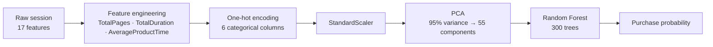

<div align="center">

# Customer Purchase Prediction

**A machine-learning web dashboard that predicts whether an online shopper will complete a purchase — with probability, confidence and live session analytics.**


[**Live Demo**](https://customer-purchase-prediction.vercel.app) · [**Source Code**](https://github.com/JeedimetlaCharan704/customer-purchase-prediction) · [Report a bug](https://github.com/JeedimetlaCharan704/customer-purchase-prediction/issues)

</div>

---

## Overview

This project turns the **UCI Online Shoppers Purchasing Intention** dataset into a real-time prediction service. A session (page visits, durations, bounce rates, page values, visitor type...) is sent to a trained Random Forest pipeline, which returns a purchase prediction together with a probability, a confidence band and derived session analytics — visualised instantly on a responsive dashboard.

Every prediction is produced by the **actual trained model**. The API never fabricates results: if the model artifacts are missing, it returns an error instead.

## Features

- **Purchase prediction** — binary Purchase / No Purchase result per session
- **Probability & confidence** — calibrated purchase probability with High / Moderate / Low confidence band
- **Session analytics** — total pages, total duration, average product time and a 0–100 engagement score
- **Four interactive charts** — class distribution, average page visits, average session duration and the monthly purchase-rate trend
- **Dataset insights** — live row counts, purchase rate and month breakdown straight from the CSV
- **Model health indicator** — shows whether the backend and artifacts are loaded
- **Responsive UI** — mobile-first breakpoints (560 px / 850 px), works on phones, tablets and desktops

## ML Pipeline



## Model Performance

Trained on 80% of **12,330** sessions, evaluated on the held-out 20% (stratified split, `random_state=42`):

| Metric | Value |
| --- | --- |
| **Accuracy** | **87.96 %** |
| **Precision** | **77.85 %** |
| **Recall** | **32.20 %** |
| **F1-score** | **45.56 %** |
| **ROC-AUC** | **85.67 %** |
| PCA components | 55 (95 % explained variance) |

> Only **15.47 %** of sessions end in a purchase (1,908 of 12,330), so the classifier is precision-oriented: when it predicts a purchase it is right about **78 %** of the time, while the ROC-AUC of **0.857** shows strong overall ranking ability across thresholds.

## Tech Stack

| Layer | Technology |
| --- | --- |
| Backend | Flask 3.1 · flask-cors |
| Machine learning | scikit-learn 1.9 (StandardScaler, PCA, RandomForestClassifier) · pandas · NumPy · joblib |
| Frontend | HTML5 · CSS3 · vanilla JavaScript · Chart.js · Inter font |
| Hosting | Vercel — Python Functions + global CDN |
| Version control | Git · GitHub |

## Project Structure

```text
customer-purchase-prediction/
├── app.py                  # Vercel entrypoint (exposes the Flask app)
├── backend/
│   └── app.py              # Flask API: predict, charts, dataset, health
├── public/                 # Static frontend (served from the CDN)
│   ├── index.html
│   ├── style.css
│   └── app.js
├── training/
│   └── train_model.py      # Full training pipeline
├── models/                 # Trained artifacts (committed)
│   ├── random_forest_model.pkl
│   ├── scaler.pkl
│   ├── pca.pkl
│   └── feature_columns.pkl
├── data/
│   └── online_shoppers_intention.csv
├── vercel.json             # Function configuration
├── requirements.txt        # Pinned dependencies
├── run_app.bat             # Windows one-click runner
└── run_mac.sh              # macOS / Linux one-click runner
```

## Getting Started

### Windows

```powershell
git clone https://github.com/JeedimetlaCharan704/customer-purchase-prediction.git
cd customer-purchase-prediction
python -m venv .venv
.venv\Scripts\activate
pip install -r requirements.txt
python training/train_model.py
python backend/app.py
```

Or simply double-click `run_app.bat`.

### macOS / Linux

```bash
git clone https://github.com/JeedimetlaCharan704/customer-purchase-prediction.git
cd customer-purchase-prediction
python3 -m venv .venv
source .venv/bin/activate
pip install -r requirements.txt
python3 training/train_model.py
python3 backend/app.py
```

Or simply run `./run_mac.sh`.

Then open **http://127.0.0.1:5001**.

> Trained artifacts are committed to the repo, so `training/train_model.py` is only needed when you change the data or hyperparameters.

## API Reference

| Method | Endpoint | Description |
| --- | --- | --- |
| `GET` | `/api/health` | Backend status and model load state |
| `GET` | `/api/dataset-summary` | Row counts, purchase rate, month breakdown |
| `GET` | `/api/charts` | Aggregated data for the four dashboard charts |
| `POST` | `/api/predict` | Predict purchase for a session payload |

```bash
curl -X POST https://customer-purchase-prediction.vercel.app/api/predict \
  -H "Content-Type: application/json" \
  -d '{
    "Administrative": 3, "Administrative_Duration": 60.5,
    "Informational": 1,  "Informational_Duration": 30.2,
    "ProductRelated": 20, "ProductRelated_Duration": 800.0,
    "BounceRates": 0.02, "ExitRates": 0.05,
    "PageValues": 12.5, "SpecialDay": 0.0, "Weekend": 1,
    "Month": "Feb", "OperatingSystems": 2, "Browser": 2,
    "Region": 1, "TrafficType": 1, "VisitorType": "Returning_Visitor"
  }'
```

## Deployment (Vercel)

The repository is pre-configured for Vercel's zero-config Flask runtime:

- `app.py` at the root exposes the Flask `app` instance
- `public/` is served statically from the CDN
- `vercel.json` sets `maxDuration: 60` so the 35 MB model has room to load on cold start
- `.python-version` pins Python 3.12
- dependencies are pinned in `requirements.txt` to match the trained artifacts

**Option A — Vercel CLI**

```bash
npx vercel login
npx vercel --prod
```

**Option B — Git integration**

1. Push this repository to GitHub
2. Import it at [vercel.com/new](https://vercel.com/new) (Flask is auto-detected)
3. Press **Deploy** — every push to `main` redeploys automatically

## Dataset

[Online Shoppers Purchasing Intention Dataset](https://archive.ics.uci.edu/dataset/468/online+shoppers+purchasing+intention+dataset) — UCI Machine Learning Repository. 12,330 sessions with 17 feature columns and a binary `Revenue` label.

---

<div align="center">

Built with **Flask**, **scikit-learn** and **Chart.js** — deployed on **Vercel**

[Source Code](https://github.com/JeedimetlaCharan704/customer-purchase-prediction) · [Live Demo](https://customer-purchase-prediction.vercel.app)

</div>
